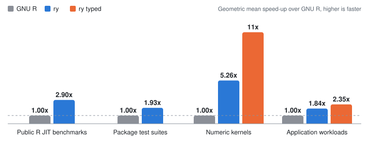

<div align="center">


# ry

**A type checker and a fast runtime for R, written in Rust.**

[**Docs**](https://ry-lang.org) ·
[**Releases**](https://github.com/felix-andreas/ry/releases) ·
[**VS Code**](https://marketplace.visualstudio.com/items?itemName=felix-andreas.ry) ·
[**Zed**](https://github.com/felix-andreas/ry/tree/main/editors/zed)

</div>

ry checks, formats and runs the R code you already have, without changes, and its checker finds
problems without running the code.

```sh
ry check    # report problems
ry fmt      # format in place
ry run      # run a script on ry's runtime, or open a console that reloads your package
```

## ry's own typed language

ry extends R with statically typed features of its own: records, tuples, tagged unions, exhaustive
`match`, typed lists and a standard library. They are ry syntax, not R, so code that uses them runs
only on ry's runtime. One example is exhaustive `match`: when you add a case to a tagged union, ry
points you at every `match` that does not handle it.

```r
alias Payment =
  | :Paid(amount: double)
  | :Refunded(amount: double)
  | :Pending

balance <- function(payment: Payment) -> double {
  match (payment) {
    :Paid(amount = a) => a
    :Refunded(amount = a) => -a
  }
}

balance(:Paid(amount = 10))
```

```
$ ry check
non-exhaustive-match

  x this `match` does not handle `:Pending`: add an arm for it, or a catch-all `_ => ...` arm
   --[payment.R:7:3]
 6 | balance <- function(payment: Payment) -> double {
 7 |   match (payment) {
   |   ^^^^^^^^^^^^^^^
 8 |     :Paid(amount = a) => a
  help: Add an arm for `:Pending` (`ry check --fix --unsafe-fixes` applies it)

1 problem in 1 file
1 fixable with `ry check --fix --unsafe-fixes`
```

The [language tour](https://ry-lang.org/ry) shows every feature.

## Speed

ry's runtime against GNU R, as the geometric mean of each benchmark suite's speed-ups:

<picture>
  <source media="(prefers-color-scheme: dark)" srcset="docs/public/bench-summary-dark.svg">
  
</picture>

<!-- bench-summary -->
| Suite | What it is | ry vs GNU R | ry typed |
| --- | --- | ---: | ---: |
| Public R JIT benchmarks | 54 standard programs from R compiler research (Ř, rcp) | 2.84x | not typed |
| Package test suites | 26 pinned CRAN packages, each running its own test suite | 1.93x | not typed |
| Numeric kernels (ours) | 16 small programs we wrote whose time goes into loops, recursion and arithmetic on numbers | 4.89x | 11x |
| Application workloads (ours) | 15 programs we wrote in the shape of package and business code: calls, dispatch, conditions, records, tables | 1.77x | 2.41x |

Geometric means of the speed-ups over GNU R; above 1x means ry is faster.

Measured on 2026-11-11 against GNU R 4.6.2 on Linux, 10 paired rounds per suite.

[Benchmarks](https://ry-lang.org/benchmarks) explains how each suite is built and measured, and shows every program, with the machine and ry commit of each suite.
<!-- /bench-summary -->

## Features

- **Checker:** `ry check` reports unresolved names, syntax errors, lint warnings and type errors,
  inferring types from plain R code without any annotations.
- **Types:** optional annotations in `#:` comments or inline syntax, with generics, unions, records
  and tagged unions. Strict mode rejects code that has no types.
- **Formatter:** `ry fmt` rewrites R files into one consistent layout, like Black for Python or
  rustfmt for Rust, so diffs show changes in logic rather than whitespace.
- **Editor:** a language server for any LSP editor (hover, completion, go to definition, rename),
  and a VS Code extension with a debugger.
- **Loader:** `ry load` reloads a package of about 300,000 lines after an edit in under 100 ms,
  where devtools `load_all()` takes about 9 s.
- **Runtime:** runs R code with a JIT compiler, loads packages with compiled code through R's C
  API, and adds `DataFrame`, a typed table built on Polars.

ry is in beta. The checker, formatter, language server and loader are ready for daily use. The
runtime is incomplete: a script that needs something it lacks stops with an error that names it, and
`ry R` runs it on GNU R instead. [Install ry](https://ry-lang.org/installation), then follow
[Adopting ry](https://ry-lang.org/guide) or take the [language tour](https://ry-lang.org/ry).

## FAQ

### Why would I need type checking?

When AI agents write much of the code, you need tools that verify a codebase without a person
reading every line, and type checking is one of them. It checks every line on every change,
including the lines no test reaches.

### Who is ry for?

Teams with R codebases of more than 100,000 lines that cannot easily move to another language.

### My R codebase isn't huge. Should I still use ry?

No. Let Claude rewrite your code in Rust.

### Why is it called ry?

It started as "the roughly good enough language server": all it offered was go-to-definition
based on regular expressions, but it was fast. It grew into a proper language server built on
tree-sitter, and people called it just Roughly. With its first type checker it was rewritten from
scratch with its own recursive-descent parser, and renamed ry.

## License

The `ry` program is GPL, like GNU R, because parts of its runtime are translated from R's own C
code. The analysis libraries (the parser, type checker, formatter and language-server features) are
UPL-1.0, so any project can reuse them. The C headers that packages compile against are
LGPL-2.1-or-later, as R's own are, so a compiled package can choose its own licence. The editor
extensions are MIT. [Licensing](https://ry-lang.org/reference/licensing/) gives the exact version
for every part.
