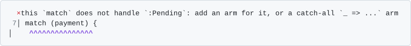

<div align="center">


# ry

**A fast R runtime with a type checker, written in Rust.**

[**Docs**](https://ry-lang.org) ·
[**Install**](https://ry-lang.org/installation) ·
[**Releases**](https://github.com/felix-andreas/ry/releases) ·
[**VS Code**](https://marketplace.visualstudio.com/items?itemName=felix-andreas.ry) ·
[**Zed**](https://github.com/felix-andreas/ry/tree/main/editors/zed)

</div>

ry is a fast R runtime, built to run your existing R code unchanged, plus a type checker and new
language features that make your code safer and faster.

```sh
ry run script.R   # run a script on ry's runtime; without a file, open ry's console
ry check          # find bugs in the R files under the current directory, without running them
ry fmt            # format the R files under the current directory in place
```

ry is in beta. The checker, formatter, editor support and package loader are ready for daily use,
but the runtime does not run all R code yet: a script that needs something it lacks stops with an
error that names it, and `ry R script.R` runs the script on GNU R instead.
[Install ry](https://ry-lang.org/installation), then follow [Adopting ry](https://ry-lang.org/guide).

## Features

### Speed

How much faster ry's runtime is than GNU R, for each benchmark suite:

<picture>
  <source media="(prefers-color-scheme: dark)" srcset="docs/public/bench-summary-dark.svg">
  
</picture>

<!-- bench-summary -->
- **Public R JIT benchmarks: 2.90x.** 54 standard programs from R compiler research (Ř, rcp).
- **Package test suites: 1.93x.** 26 pinned CRAN packages, each running its own test suite.
- **Numeric kernels: 5.26x, 11x in typed ry.** 16 small programs we wrote whose time goes into loops, recursion and arithmetic on numbers.
- **Application workloads: 1.84x, 2.35x in typed ry.** 15 programs we wrote in the shape of package and business code: calls, dispatch, conditions, records, tables.

Each number is the geometric-mean speed-up over GNU R 4.6.2 (above 1x is faster), from 10 paired rounds on Linux. [Benchmarks](https://ry-lang.org/benchmarks) shows every program and how it is measured.
<!-- /bench-summary -->

### Type checker

`ry check` finds bugs before the code runs. On plain R, with no configuration and no annotations,
it reports names that do not resolve, syntax errors, values that are never read, and lints such as
`x == NA` or `T` for `TRUE`, and `ry check --fix` applies the fixes that are safe.

Set `typing = true` in `ry.toml`, and it also infers types from the same plain R and reports type
errors:

```r
apply_discount <- function(price, rate) price * (1 - rate)
apply_discount(100, "0.2")
# type-mismatch: expected a numeric value (`integer` or `double`), found `character`
```

Where inference is not enough, you write a type yourself, either in a `#:` comment such as
`#: fn(price: double, rate: double) -> double`, which keeps the file plain R, or inline, as in
`function(price: double, rate: double) -> double`. Strict mode (`strict = true`) rejects every
value whose type is not known, and `ry check --annotate` writes the inferred types into your files.
[→ Adopting ry](https://ry-lang.org/guide#step-2-type-your-code)

### The ry language

On top of R, ry adds a small typed language of its own: records, tuples, tagged unions with
exhaustive `match`, errors as values, nominal types, a typed `DataFrame` built on Polars, and a
standard library. Code that uses them runs only on ry's runtime, and the plain R code beside it
keeps working. When you add a case to a tagged union, `ry check` points you at every `match` that
does not handle it:

```r
alias Payment =
  | :Paid(amount: double)
  | :Refunded(amount: double)
  | :Pending

balance <- function(payment: Payment) -> double {
  match (payment) {
    :Paid(amount = a) => a
    :Refunded(amount = a) => -a
  }
}

balance(:Paid(amount = 10))
```



[→ Language tour](https://ry-lang.org/ry)

### More

- **Editor support.** A language server for VS Code, Zed and any other LSP editor: diagnostics as
  you type, hover with inferred types, completion, go to definition, references, rename and quick
  fixes. [→ Editors](https://ry-lang.org/installation#editors)
- **Formatter.** `ry fmt` gives every R file one consistent layout, so diffs show changes in logic
  rather than whitespace. [→ Formatting rules](https://ry-lang.org/reference/formatting-rules)
- **Package loader.** `ry load`, and `ry run` inside a package, load the package from source like
  devtools' `load_all()`, but lazily, and reload only what you changed: on a package of about
  300,000 lines, a reload takes under 100 ms instead of about 9 s.
  [→ Package loading](https://ry-lang.org/reference/package-loading)

## FAQ

### Why would I need type checking?

When AI agents write much of the code, you need tools that verify a codebase without a person
reading every line, and type checking is one of them. It checks every line on every change,
including the lines no test reaches.

### Who is ry for?

Teams with R codebases of more than 100,000 lines that cannot easily move to another language.

### My R codebase isn't huge. Should I still use ry?

No. Let Claude rewrite your code in Rust.

### Why is it called ry?

It started as "the roughly good enough language server", which people shortened to Roughly. When it
gained a type checker, it was rewritten from scratch and renamed ry.

## License

The `ry` program is GPL, like GNU R, because parts of its runtime are translated from R's own C
code. The analysis libraries (the parser, type checker, formatter and language-server features) are
UPL-1.0, so any project can reuse them. The C headers that packages compile against are
LGPL-2.1-or-later, as R's own are, so a compiled package can choose its own licence. The editor
extensions are MIT. [Licensing](https://ry-lang.org/reference/licensing/) gives the exact version
for every part.
